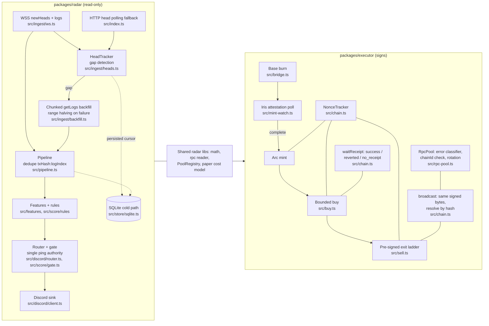

# ak-arc

On-chain liquidity radar and cross-chain bridge-and-swap executor for the Arc chain, part of the ak toolkit.

## Problem

Arc is Circle's L1: USDC is the gas token, blocks land roughly every half
second, and native USDC moves between Base and Arc through Circle's CCTP.
Two practical problems follow.

1. **Observing it reliably.** Public RPCs are HTTP-only and throttle bursts,
   provider plans cap `eth_getLogs` at a few blocks, and WebSockets drop. A
   watcher has to keep a gap-free view of pool, launchpad, wallet and bridge
   events across disconnects and restarts, without double-reporting, and
   only escalate (Discord `@everyone`) on a small set of hard rules.
2. **Acting on it safely.** Moving capital in means a CCTP burn on Base, an
   attestation from Circle's Iris API of unknown latency, a mint on Arc, then
   a swap into a thin pool that is also the exit. Each step crosses an
   unreliable RPC, and a misread failure (a timeout treated as "not sent", a
   throttle treated as "zero balance") costs money.

This repository holds both halves: `packages/radar` (event ingestion,
scoring, alerting; read-only) and `packages/executor` (transaction
execution; holds the only signing key).

## Architecture



Radar (`packages/radar`):

- **WSS ingest** subscribes to `newHeads` and topic-allowlisted `logs`, with exponential backoff, a stall watchdog and auto-resubscribe: `packages/radar/src/ingest/ws.ts`.
- **HTTP polling fallback** when no WSS endpoint exists; the next poll starts only after the previous one finished: `packages/radar/src/index.ts`, `packages/radar/src/ingest/heads.ts`.
- **Gap backfill** re-fetches `[lastHead, chainHead]` in RPC-sized chunks and halves a failing range down to a single block instead of dropping logs: `packages/radar/src/ingest/backfill.ts`.
- **Dedupe** on `txHash:logIndex` in a bounded seen-set, so WSS/backfill overlap never double-processes a log: `packages/radar/src/ingest/dedupe.ts`, `packages/radar/src/decode/index.ts` (`logId`).
- **Persisted cursor** (`lastBlock:<chainId>` in SQLite); a restart backfills the gap, bounded by `BACKFILL_MAX_BLOCKS`: `packages/radar/src/index.ts`, `packages/radar/src/store/sqlite.ts`.
- **Scoring and gate**: rules emit signals; `decide()` in the gate is the only code that can set `@everyone`: `packages/radar/src/score/rules/`, `packages/radar/src/score/gate.ts`, `packages/radar/src/discord/router.ts`.
- **Discord sink**: per-channel serial queue, honours 429 `retry_after`, dry-run by default: `packages/radar/src/discord/client.ts`.

Executor (`packages/executor`):

- **CCTP attestation poll as the trigger**: the mint (and then the buy) fires only when Iris reports the burn's attestation `complete`: `packages/executor/src/mint-watch.ts`, `packages/executor/src/run.ts`.
- **Nonce manager**: read once (`pending`), then incremented locally; never re-read between mint and buy: `packages/executor/src/chain.ts` (`NonceTracker`).
- **Same-signed-bytes rebroadcast**: on a transport error the identical raw tx is re-sent after a lookup by hash; node rejections are final: `packages/executor/src/chain.ts` (`broadcast`).
- **Three-outcome receipts**: `success`, `reverted` (nonce consumed) and `no_receipt` (counter unknown, abort): `packages/executor/src/chain.ts` (`waitReceipt`).
- **RPC pool**: classifies every error (transient, quota/auth, on-chain answer, node rejection), asserts each endpoint's chainId at first use, rotates after N transport failures: `packages/executor/src/rpc-pool.ts`.
- **Pre-signed exit ladder**: every sell tier of every held position is signed ahead of the keypress at the current nonce and re-signed after each fire or refresh: `packages/executor/src/sell.ts`.
- **Shared radar libraries**: unit conversion, the rate-limited reader, `PoolRegistry` and the paper cost model are imported from `packages/radar/src`, not re-implemented: `packages/executor/src/{chain,rpc-pool,pool,buy,sell,impact}.ts`.

## Technical choices and trade-offs

1. **In-process hot path, SQLite only on the cold path.** Decode, features, scoring and routing run in one process queue; persistence (cursor, alert fires, precision samples) is asynchronous. Lower alert latency and no database on the alert path, at the cost of state that must be rebuilt after a restart; warm start replays the last N hours with Discord muted to do that (`packages/radar/src/pipeline.ts`, `packages/radar/src/ingest/warm-start.ts`, `WARM_START_HOURS`).
2. **One ping authority.** Only the gate can set `@everyone`, only in `#alerts`, only for four hard rules; anything uncertain goes to a specialty channel without a ping. Fewer pings by construction, enforced by tests rather than convention (`packages/radar/src/score/gate.ts`, `packages/radar/test/alerts/gate.test.ts`, `packages/radar/test/alerts/matrix.test.ts`).
3. **HTTP polling as an explicit opt-in on mainnet.** The live process refuses to start on mainnet without a WSS URL unless `ALLOW_MAINNET_HTTP_POLLING=1`; the code documents the polling mode as about 2–3 s behind the chain with no SLA on the public RPC. Availability on a public endpoint versus latency (`packages/radar/src/config/env.ts`, `packages/radar/config/profiles/mainnet-poll.env`).
4. **Range halving instead of fixed chunking for `getLogs`.** Ranges that fail (too large, too many results, 503) are split down to one block, so an oversized range costs extra calls rather than silently missing logs; a single failing block still throws (`packages/radar/src/ingest/backfill.ts`, `packages/radar/test/alerts/warm-start.test.ts`).
5. **A failed read is never state.** In the executor every RPC error is classified before anything reacts to it; reads that matter (balances, allowances, nonce, cached-pool assertions) are retried across every live endpoint and only then abort with "all N/M endpoints failed", which is distinct from a real on-chain answer. More RPC calls and more abort paths in exchange for not acting on a throttle as if it were a zero (`packages/executor/src/rpc-pool.ts`, `packages/executor/test/unit/rpc-pool.test.ts`).
6. **Impact is reported, not enforced.** The pre-trade guards are a per-token depth floor, a dominance ratio (deepest fee tier ≥ 20× the runner-up) and `minOut` from `slippageBps`; the round-trip cost model is shown but does not block. Sizing stays an operator decision; the module owns correctness (`packages/executor/docs/invariants.md`, `packages/executor/src/impact.ts`).
7. **Secrets split by file type.** `.env` holds keys, URLs and kill-switches; `config/executor.json` holds everything else and is scanned before schema validation, so a URL-shaped or 64-hex value aborts startup. The radar is tested never to read the executor's `.env` (`packages/executor/src/config.ts`, `packages/radar/test/unit/repo-layout.test.ts`).

## What broke and how I fixed it

- **Global lockfile blocked unrelated runs.** Symptom: a single global lock blocked six unrelated bridges run with different keys in one day. Cause: the lock was keyed on the process, not the wallet. Fix: one lock per wallet address (`data/executor-<address>.lock`), released on normal exit and on SIGINT (`packages/executor/src/chain.ts`, `packages/executor/test/unit/lock.test.ts`).
- **Receipt did not mean readable state.** Symptom: state read right after a receipt was not yet updated. Cause: Base serves sub-second preconfirmation receipts. Fix: after any tx the next one depends on, poll the actual state (`pollState`): Base allowance, Arc USDC balance after the mint, router allowances (`packages/executor/src/chain.ts`).
- **Option-shaped arguments eaten by npm.** Symptom: flags passed through `npm run … --` never reached the stage. Cause: npm rewrites option-shaped arguments into its own config, even after `--`. Fix: no npm scripts for stages; every run is `npx tsx`, and an npm-launched stage aborts with a one-line message (`packages/executor/src/config.ts`, `NPM_MESSAGE`).
- **Public RPC bursts looked like on-chain answers.** Symptom: "could not complete this request" and empty-reason reverts during bursts. Cause: throttling wrapped by viem as a revert. Fix: the RPC pool's error classifier, rotation after `ARC_RPC_ROTATE_AFTER` transport failures, endpoint drop on quota/auth refusals, and rebroadcast of the same signed bytes after a lookup by hash (`packages/executor/src/rpc-pool.ts`, `packages/executor/src/chain.ts`).
- **Dust pools.** Symptom: a token had three fee tiers holding < $0.001 USDC beside one deep pool; filling a dust tier is ~100% impact, and a dust trade could also fake a price move. Cause: tier selection by existence, price by any pool. Fix: the dominance-ratio guard in the executor and a single price source pool per major (deepest trusted pool ≥ `MAJOR_PRICE_MIN_LP_USD`) in the radar (`packages/executor/src/impact.ts`, `packages/radar/src/features/majors.ts`).
- **Fast Transfer downgraded silently.** Symptom: attestation took far longer than the Fast Transfer target. Cause: a `maxFee` sized for a small amount is too low above ~15 USDC, and CCTP then downgrades to Standard Transfer instead of reverting. Fix: quote the fee from Iris immediately before every burn, abort if the threshold-1000 quote is missing, and emit `bridge.downgrade_detected` when attestation latency breaches `timing.fastTransferTargetMs` (`packages/executor/src/bridge.ts`, `packages/executor/src/mint-watch.ts`).
- **CCTP mints never decoded.** Symptom: a 24 h backtest recorded 0 `bridge_mint` events. Cause: `finalityThresholdExecuted` is indexed on Arc's `MessageReceived`, so the guessed ABI failed viem's strict topic-count check and the error was swallowed. Fix: corrected ABI, verified against a recorded mainnet mint (`packages/radar/src/abi/cctp.ts`, `packages/radar/test/fixtures/mainnet-real.test.ts`).
- **Bridge inflows inflated by 1e12.** Symptom: a ~$1 mint priced as ~$1 trillion. Cause: the system emitter's `Transfer.value` is native 18-decimal USDC, but it was divided using the 6-decimal ERC-20 mirror's decimals. Fix: native decimals for that emitter, pinned by the recorded mint fixture (`packages/radar/src/pipeline.ts`, `onBridgeInflow`).

## Getting started

Requires Node.js ≥ 22.13.

```bash
npm install && npm test
```

`npm test` is fully offline: radar unit, fixture-replay and alert-matrix
suites, then executor unit tests. No RPC, no Discord, no key. `npm run
typecheck` runs `tsc --noEmit` on both packages.

Running anything live is per package (see `packages/radar/README.md` and
`packages/executor/README.md`). The radar needs an Arc RPC (and Discord
webhooks to post). The executor's `--dry-run` (the default) still needs a
`PRIVATE_KEY`, live Base and Arc RPCs and gas on the wallet, because it
reads real balances, allowances, fee quotes and pool state. An offline
execution simulation is `[TODO: not implemented]`.

## Configuration

Each package reads its own `.env` (copy from `.env.example`). The full
list, with defaults, is in each `.env.example`.

### packages/radar

| Variable | Required | Meaning |
|---|---|---|
| `ARC_NETWORK` | no (default `testnet`) | `testnet` or `mainnet` |
| `ARC_TESTNET_HTTP_URL` / `ARC_MAINNET_HTTP_URL` | yes, for the selected network | HTTP RPC (`ARC_HTTP_URL` overrides) |
| `ARC_TESTNET_WSS_URL` / `ARC_MAINNET_WSS_URL` | on mainnet, unless `ALLOW_MAINNET_HTTP_POLLING=1` | WebSocket RPC (`ARC_WSS_URL` overrides) |
| `ALLOW_MAINNET_HTTP_POLLING` | no (default `0`) | opt in to HTTP polling on mainnet |
| `ARC_PROFILE` | no | load a non-secret preset from `config/profiles/<name>.env` |
| `DISCORD_WH_SMART_FLOW`, `DISCORD_WH_MAJOR_COINS`, `DISCORD_WH_LAUNCHPADS`, `DISCORD_WH_ALERTS` | to post (a channel without a webhook is dropped with a warning) | one webhook per channel |
| `DISCORD_DRY_RUN` | no (default `1`) | log payloads instead of posting |
| `ALERTS_PING_ENABLED` | no (default `1`) | `0` disables every `@everyone`; alerts still post |
| `ALERT_*`, `BRIDGE_*`, `MAJOR_*`, `PAD_*`, `EARLY_BUYER_*`, `CLUSTER_MIN_WALLETS`, `DEDUPE_SEC` | no | rule thresholds and digest cadences |
| `RPC_GETLOGS_MAX_RANGE`, `RPC_MAX_RPS`, `BACKFILL_MAX_BLOCKS`, `HEAD_STALL_SEC`, `POLL_INTERVAL_MS`, `WARM_START_HOURS` | no | ingestion limits |
| `HOLDERS_*` | no | background holder backfill job |
| `PAPER_LATENCY_MS`, `PAPER_SIZE_USD` | no | paper scorecard (never affects posting) |
| `DB_PATH`, `WATCHLIST_DIR`, `LOG_LEVEL` | no | storage and logging |

### packages/executor

| Variable | Required | Meaning |
|---|---|---|
| `PRIVATE_KEY` | yes (every stage, including dry run) | signing key, same address on Base and Arc |
| `BASE_RPC_URL` | no (default public Base RPC) | Base HTTP RPC |
| `ARC_MAINNET_HTTP_URL` | no (default public Arc RPC) | comma-separated failover list |
| `ARC_RPC_ROTATE_AFTER` | no (default `3`) | consecutive transport failures before rotating |
| `ARC_MAINNET_WSS_URL` | no | WebSocket for the sell TUI; HTTP polling otherwise |
| `ARC_RPC_MAX_RPS`, `ARC_RPC_RETRY_BASE_MS` | no (defaults `5`, `400`) | reader rate and backoff base |
| `IRIS_API_URL` | no (default production Iris) | Circle attestation API |
| `DISCORD_WH_EXECUTOR` | no | one webhook for every stage; never pings |
| `DISCORD_DRY_RUN` | no (default `1`) | log payloads instead of posting |
| `EXECUTION_DRY_RUN` | no (default `1`) | nothing is signed; `--live` overrides per run |
| `EXTRA_TOKENS` | no | extra tokens for the sell TUI |
| `PENDING_BURN_TX` | no | `status.ts` only: burn tx to report on |

Non-secret executor settings (route, target token, guards, timing, gas,
notifications) live in `packages/executor/config/executor.json`, which ships
with a placeholder target token and pool that must be replaced before any
live run.

## Tests

Observed passing on a clean `npm ci` (Vitest):

| Package | Suite | Tests |
|---|---|---|
| radar | `test:unit` (14 files) | 168 |
| radar | `test:fixtures` (2 files, offline log replay → Discord payload snapshots) | 27 |
| radar | `test:alerts` (4 files, ping / no-ping matrix, warm start, holder backfill) | 41 |
| executor | `test:unit` (8 files) | 114 |
| **total** | | **350** |

Not part of `npm test` because they need a live RPC or post to Discord:
radar `test:chain-probe`, `probe:mainnet`, `test:webhooks`, `harness`.

## Part of ak

ak is an umbrella toolkit with one repository per chain or component
(ak-core, ak-arc, ak-deploy, more to follow). ak-arc is the Arc chain
component.

## Status and limitations

- Live operation figures are not in this repository: uptime `[TODO]`, alert precision `[TODO]`, live execution runs and tx/revert counts `[TODO]`, measured end-to-end latencies `[TODO]`.
- The executor has no offline simulation; its dry run reads mainnet state with a real key (see Getting started).
- Radar mainnet coverage gaps are listed in `packages/radar/README.md` ("Known gaps / TODO"): several launchpads have no factory address or decoder yet, graduations only fire for generic pads, and token/token pools are not USD-scored.
- Holder counts are approximate (`holders≈`, Transfer participants).
- CCTP domain 26 on mainnet was verified by observation, not from Circle's documentation, at the time of writing.
- Designs and thresholds were tuned on Arc's early mainnet; treat every threshold as a starting point.

## License

MIT, see [LICENSE](LICENSE).
